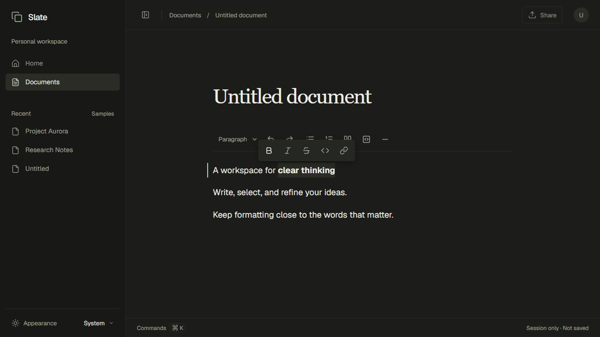

# Slate

A rich-text editor that keeps formatting close to the text you're working on.

[Open the editor](https://relay-hacks16.vercel.app) · [Architecture](docs/architecture.md) · [Editor-engine decision](docs/adr/0001-editor-engine.md)



Selecting text reveals inline controls; the captured phrase has bold formatting applied. This screenshot predates local autosave; current save status appears in the footer.

## Local autosave and recovery

The workspace has light and dark themes and a collapsible sidebar. Document
switching and sharing are not available. The current document is saved in this browser after a short pause in typing and
restored on refresh. This is local storage, not cloud sync. Clearing site data
removes it, and each browser and site address has its own copy. Real-time
collaboration and server storage are still planned.

The footer shows the actual save state. If storage is unavailable, a write fails,
or saved data cannot be restored, a recovery notice offers a draft download.
Unreadable records are left untouched. Another tab changing the saved record
stops autosave; download the current draft before reloading. The title is saved
with the document but remains a static heading in this phase.

## The problem

Editing a document involves switching between writing, selecting text, and finding the right formatting command. Slate explores an interface where block controls stay above the document and inline controls appear with the selection.

The current implementation is a single-user editor with browser-local persistence. Document review and collaboration are future milestones.

## Try it in one minute

1. Open the editor and write a heading followed by a paragraph.
2. Select a phrase to reveal the contextual toolbar. Apply bold or add a link.
3. Turn another paragraph into a list or quote, then try undo and redo.
4. Switch themes and collapse the sidebar to compare the writing space.

Wait for **Saved locally**, then refresh to check that your document returns. Storage belongs to this browser and site address.

## Engineering work in this repository

The project implements the workspace, document canvas, formatting controls, selection-state integration, and editor behavior tests. Tiptap and ProseMirror supply the editing engine, document model, transactions, and history.

That boundary matters: the custom work is the interaction and integration layer around the engine. Storage and synchronization are separate responsibilities.

## Architecture

```text
Next.js application
  └─ Workspace and document canvas
       └─ Editor feature
            ├─ React formatting controls
            ├─ Tiptap lifecycle, extensions and commands
            └─ ProseMirror document, selection and history
```

The web app lives in `apps/web`; shared TypeScript configuration lives in `packages/config`. Feature directories separate the workspace shell from the document canvas and editor. There is no backend service in the current implementation.

## Key decisions and tradeoffs

- **Use an established editing engine.** Tiptap avoids implementing browser selection, clipboard behavior, and history from scratch. In exchange, extensions and dependency updates need compatibility checks.
- **Keep persistence separate from the editor instance.** The documents feature validates and stores a versioned record while Tiptap owns live content. Unsupported records remain untouched; future schema changes require explicit migration tests.
- **Test editor behavior, then check browser interaction separately.** Automated tests cover content, formatting, links, selection state, and history. Native selection and focus still need real-browser validation.

## Current limits

Document switching, sharing, cloud storage, and real-time collaboration are not available. Browser-local storage is not a backup: clearing site data removes it, quota restrictions can prevent saving, and lifecycle saves are best-effort. Cross-tab checks detect common conflicts but do not provide locking or merging.

## Run locally

Use Node.js 24.x and pnpm 10.34.6. Both versions are recorded in the repository.

```sh
npm install --global pnpm@10.34.6
pnpm install --frozen-lockfile
pnpm dev
```

Open [localhost:3000](http://localhost:3000). No environment variables or external
services are needed. Add configuration names to `.env.example` when they are
introduced, and keep populated `.env` files out of Git.

| Command             | Purpose                                       |
| ------------------- | --------------------------------------------- |
| `pnpm dev`          | Start the development server                  |
| `pnpm start`        | Serve an existing production build            |
| `pnpm check`        | Run formatting, lint, types, tests, and build |
| `pnpm format`       | Format code and documentation                 |
| `pnpm format:check` | Check formatting                              |
| `pnpm lint`         | Run ESLint with no warnings allowed           |
| `pnpm typecheck`    | Generate route types and check TypeScript     |
| `pnpm test`         | Run Vitest tests                              |
| `pnpm build`        | Create a production build                     |

The Makefile provides the same checks. Tests cover editor content, formatting,
selection state, links, undo/redo, and local save/recovery behavior. Browser checks are also needed for native
selection, keyboard focus, and layout; jsdom cannot reproduce those fully.

## Repository

```text
apps/web/           Next.js application
  src/app/          Routes and root layout
  src/features/     Workspace, document canvas, and editor
  src/styles/       Tokens and global styles
packages/config/    Shared TypeScript settings
docs/               Architecture, design, roadmap, and decisions
.github/workflows/  Frontend CI
```

The frontend uses React, TypeScript, and Tiptap over ProseMirror. A pnpm workspace
keeps the web application separate from shared configuration. Future service
code will be added when it is needed; there are no backend services yet.

## Documentation

- [Contributing](CONTRIBUTING.md)
- [Architecture](docs/architecture.md)
- [Design system](docs/design-system.md)
- [Roadmap](docs/roadmap.md)
- [Editor engine decision](docs/adr/0001-editor-engine.md)

## License

[MIT](LICENSE).
